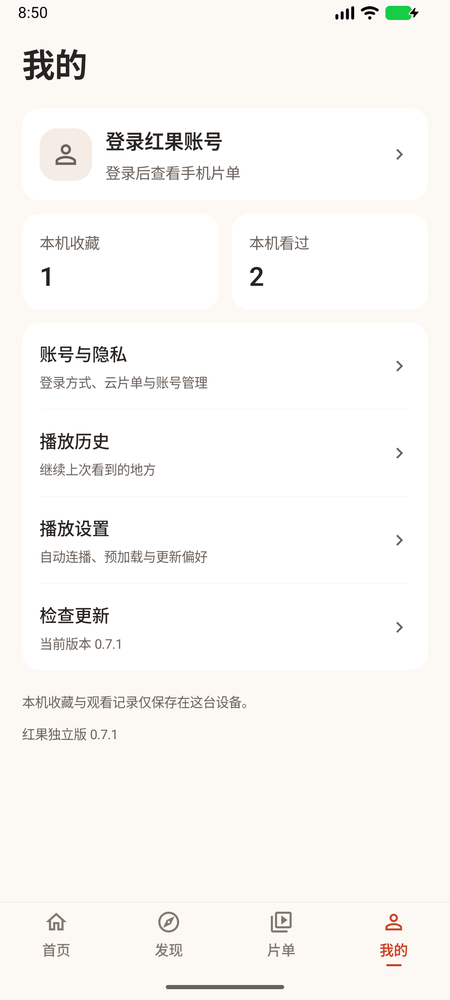

<div align="center">

# 红果独立版

**在手机上发现好剧，随时接着看。**

基于 Kotlin、Jetpack Compose 与 Media3 构建的原生 Android 短剧客户端。<br>请求、媒体处理、缓存与播放均在本机完成，无需部署服务器或配置 API key。

[](https://github.com/OOIUa/hongguo-android/releases/latest) [](#下载与安装) [](#功能一览) [](LICENSE)

[**下载 APK**](https://github.com/OOIUa/hongguo-android/releases/latest) · [界面预览](#界面预览) · [使用说明](#快速上手) · [源码构建](#源码构建) · [反馈问题](https://github.com/OOIUa/hongguo-android/issues)

</div>

## 下载与安装

当前发布版本：**v0.6.0**（versionCode 7）· Android **8.0 / API 26** 及以上。

本版新增个人红果账号、账户片单和可选进度上报。账号功能仍处于测试阶段，登录与同步结果需用本人账号核对；接入方式与使用范围见 [接入说明](docs/ACCOUNT_INTEGRATION.md)。

| 下载方式 | 链接 |
| --- | --- |
| GitHub 直连 | [下载 v0.6.0 APK](https://github.com/OOIUa/hongguo-android/releases/download/v0.6.0/hongguo-android-0.6.0.apk) |
| 加速线路 1 | [通过 gh-proxy.com 下载](https://gh-proxy.com/https://github.com/OOIUa/hongguo-android/releases/download/v0.6.0/hongguo-android-0.6.0.apk) |
| 加速线路 2 | [通过 ghfast.top 下载](https://ghfast.top/https://github.com/OOIUa/hongguo-android/releases/download/v0.6.0/hongguo-android-0.6.0.apk) |
| 发布说明与源码 | [全部版本](https://github.com/OOIUa/hongguo-android/releases) · [v0.6.0 完整源码](https://github.com/OOIUa/hongguo-android/releases/download/v0.6.0/hongguo-android-0.6.0-source.zip) · [SHA-256 校验文件](https://github.com/OOIUa/hongguo-android/releases/download/v0.6.0/SHA256SUMS-0.6.0.txt) |

下载后打开 APK，按 Android 系统提示完成安装。GitHub 连接不畅时可尝试加速线路，公共代理的可用性取决于网络与服务状态。

> **已有旧版？请直接覆盖安装，保留收藏、历史与续播位置。** 同签名版本可覆盖升级；卸载或清除应用数据会删除本机记录。0.1 / 0.2 版本需先手动覆盖安装一次新版，0.3.0 起支持应用内更新，0.4.0 起支持加速线路。

## 界面预览

<table>
  <tr>
    <th align="center">首页推荐</th>
    <th align="center">分类筛选</th>
    <th align="center">我的观影空间</th>
  </tr>
  <tr>
    <td></td>
    <td></td>
    <td></td>
  </tr>
</table>

截图来自 v0.5.1 的 Android 模拟器，内容列表随上游更新。

## 功能一览

| 功能 | 说明 |
| --- | --- |
| 发现好剧 | 热度精选、最新短剧、漫剧榜单，支持继续翻页 |
| 分类与搜索 | 浏览短剧、漫剧、AI 剧，按上游提供的条件筛选，或直接搜索剧名 |
| 全屏播放 | 上划下一集、下划上一集，也可打开选集面板跳转 |
| 播放控制 | 暂停 / 继续、拖动进度、缓冲进度显示、播放失败重试 |
| 六档倍速 | 0.5×、0.75×、1×、1.25×、1.5×、2×，自动记住选择 |
| 连播与预加载 | 可分别开关自动连播、下一集预加载，末集不循环 |
| 收藏与续播 | 本机保存收藏、观看历史、集数与集内位置，支持单条移除与清空 |
| 个人红果账号 | 官网网页登录、官方 App 扫码与手机号验证码入口；账号资料验证后加密保存 |
| 账户片单 | 读取账户收藏、最近 50 部观看历史及已上线 / 待上线预约，与本机记录分开 |
| 可选进度上报 | 默认关闭；开启后仅上报实际播放的进度，支持本机持久待同步队列 |
| 边播边缓存 | 对支持的片源按需下载与处理，不兼容时回退完整缓存播放 |
| 应用内更新 | 手动 / 启动检查，支持直连、两条加速线路及自动切换 |

首页按热度、上新及榜单展示内容；收藏和观看历史各最多保存 **200 部**，两份列表独立管理。

## 快速上手

1. 安装后从「首页」或「分类」选剧，也可到「搜索」输入剧名。
2. 进入详情，选择集数开始播放；看过的剧可继续上次的集数与位置。
3. 播放中点击画面暂停 / 继续，拖动进度条跳转，上下滑动切集；右下角「倍速」调整速度。
4. 在详情或播放器中收藏，在「收藏」查看；「我的 → 播放历史」可继续观看。
5. 到「我的 → 系统设置」调整自动连播、下一集预加载和启动检查更新。
6. 到「我的 → 红果账号与云片单」登录个人账号；只有一部手机时选择「在本机打开官网登录」，待页面加载后点「打开官网登录窗口」，自行完成官方验证后点上方「完成登录」。也可在另一台设备的红果 App 中扫码确认。

应用需要联网访问上游内容源，无需填写服务器地址。切到后台会停止播放与预加载。

## 在线更新

打开「**我的 → 检查更新**」即可手动检查。开启启动检查后，应用在启动且距上次检查已满 24 小时时检查一次；没有新版或检查失败时不弹窗。

发现新版后，点击「下载更新」才开始下载。下载完成会校验文件大小、SHA-256、包名、版本、最低系统要求与签名，再交给 Android 系统确认安装。首次更新可能需要允许本应用安装来自此来源的应用。

更新窗口可选择「自动切换」「GitHub 直连」「加速线路 1」「加速线路 2」，选择保存在本机。自动模式依次尝试三条线路；取消下载会停止本次任务。安装包使用相同的完整性与签名校验。

发布源为本仓库的 [GitHub Releases](https://github.com/OOIUa/hongguo-android/releases)，更新清单为 [update.json](https://github.com/OOIUa/hongguo-android/releases/latest/download/update.json)。只有更高的 `versionCode` 才会提示更新。下载与安装均由用户操作确认。

## 播放、缓存与本机数据

- **渐进播放**：常见非碎片 CENC MP4 使用 Range 按需取块并在本机处理，首帧无需等待整集下载。不支持此路径的媒体会回退为整集下载、处理后播放；实际效果取决于片源、编码、封装与网络。
- **本机记录**：收藏、历史、播放偏好与缓存保存在应用私有目录，无需广泛文件访问权限。历史在实际渲染首帧后记录，准备失败不会记为已观看。
- **账号记录**：个人会话和账户片单加密保存在本机，退出或切换账号隔离数据。原本机记录不会自动上传；详情和播放器中的「账号收藏」是独立的云端操作。短信可能需要官网验证，收藏与跨设备续播需用本人账号核对。
- **缓存用途**：用于播放加速，可能随会话结束或空间策略被清理，不作为永久离线保存。目前仅支持前台播放，未提供后台播放服务或批量离线下载。

<details>
<summary>预加载与缓存额度</summary>

下一集预加载仅在应用处于前台、开关开启、当前集已渲染首帧且缓冲至少 5 秒后启动。除索引与样本探测外，额外预热最多 512 KiB 的文件前段；关闭开关或切到后台后停止预加载。

渐进缓存与完整缓存各有独立的 512 MiB 额度。不完整的渐进缓存会在会话关闭时清除，缓存也可能按空间策略淘汰。调整倍速保留当前播放位置和暂停状态，并在切集、连播及再次打开应用时继续使用。

</details>

## 源码构建

### 环境准备

- JDK **17 或 21**。
- Android SDK **Platform 36**，通过 `ANDROID_HOME` 或本机 `local.properties` 中的 `sdk.dir` 指定 SDK 位置。
- 仓库已包含 **Gradle Wrapper**；首次构建需要联网下载 Gradle 与依赖。也可使用 Android Studio 打开项目。

```bash
git clone https://github.com/OOIUa/hongguo-android.git
cd hongguo-android
```

Windows / PowerShell：

```powershell
.\gradlew.bat :app:assembleDebug :app:testDebugUnitTest :app:lintDebug
```

Linux / macOS：

```bash
chmod +x gradlew
./gradlew :app:assembleDebug :app:testDebugUnitTest :app:lintDebug
```

APK 产物：`app/build/outputs/apk/debug/app-debug.apk`。

有 Android 设备或模拟器时，可运行设备测试：

```powershell
.\gradlew.bat :app:connectedDebugAndroidTest
```

Linux / macOS 使用 `./gradlew` 执行同一任务。联网用例会访问真实上游内容并下载视频，可用性与耗时取决于网络和内容源。

> 当前发布包沿用既有测试签名。自行构建时自动生成的其他测试密钥无法覆盖现有安装。发布须保留同一密钥并核对 [公开证书指纹](release-signing.sha256)；构建发布资产、对应源码和更新清单的步骤见 [发布指南](RELEASING.md)。

### 项目结构

```text
app/src/
├── main/
│   ├── java/com/hongguo/android/  # Compose 界面、播放、收藏历史与在线更新
│   ├── java/com/hongguo/api/      # Java 请求、签名与媒体处理核心
│   └── assets/                   # 上游参数与许可证通知
├── test/                         # JVM 回归测试
└── androidTest/                  # Android 设备与播放验证
scripts/prepare-release.ps1       # 发布资产生成脚本
```

### 验证范围

[验证记录](VALIDATION.md) 包含构建、静态检查、模拟器回归及覆盖更新的数据保留记录。实体手机、Android 8–15 设备及全部编码 / MP4 布局尚未全面验证，账号功能的实际登录与同步结果需由本人核对。

## 常见问题

**需要部署后端或安装 Node.js / FFmpeg 吗？**

不需要。请求、签名、媒体处理、缓存与播放在 APK 内执行，手机仍需联网访问内容源。

**为什么有些剧集需要等待较久？**

支持渐进播放的片源可以边播边缓存；不兼容时会先下载整集并处理。网络、上游响应与媒体格式都会影响准备时间，不能保证所有片源都能立即起播。

**能离线保存剧集或同步收藏吗？**

缓存仅用于播放加速，不提供永久离线保存。登录个人账号后可读取云端片单，并主动开启本次观看进度上报。本机旧记录不会自动上传，历史与预约按固定批次读取。卸载或清除应用数据会删除本机记录。

**更新下载失败怎么办？**

在更新窗口切换线路重试，或从本文的 APK 下载链接手动覆盖安装。保留旧版应用数据，避免先卸载。

**如何反馈问题？**

请在 [Issues](https://github.com/OOIUa/hongguo-android/issues) 提供应用版本、Android 版本、手机型号、复现步骤与错误截图。播放问题可补充剧名和集数，方便定位。

## 来源与许可证

本 Android 应用按 **GPL-3.0-only** 分发。协议与媒体核心参考 [sunnysky123/hongguo-web](https://github.com/sunnysky123/hongguo-web)，其中部分实现注明来自 [jackotom/hongguo-drama](https://github.com/jackotom/hongguo-drama)；保留原有来源注释及 MIT / GPL 通知。

完整条款、来源版本与改动说明见 [LICENSE](LICENSE) 和 [第三方通知](THIRD_PARTY_NOTICES.md)。发布 APK 时应同时提供该版本对应的完整源码与构建文件。
